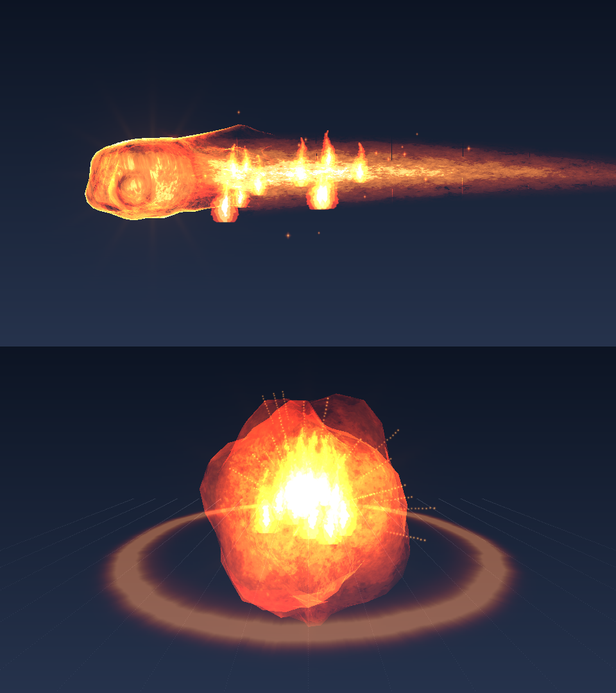

# BlackOcean Skills (블랙오션 스킬) — 화염 주먹

R 키를 누르면 손에 불꽃이 모였다가 **거대한 3D 화염 주먹**이 날아가고, 맞은 자리에서 폭발·충격파·불씨·연기가 퍼지는 스킬입니다.
NeoForge 1.21.1 전용. **추가로 설치할 모드가 없습니다** (이 jar 하나로 서버 판정 + 화면 연출 모두 동작).


> 위 그림은 모드의 셰이더 수식을 그대로 옮겨 그린 **근사 미리보기**입니다. 실제 게임 화면은 조명·배경에 따라 다릅니다.

---

## 1. 빌드하는 법

1. **JDK 21** 이 필요합니다 (돛 애드온 때 설치했다면 그대로 사용).
2. 이 폴더의 **`빌드하기.bat`** 을 더블클릭합니다. 처음엔 5~10분 걸립니다.
3. 끝나면 `build\libs\blackocean_skills-1.0.0.jar` 가 생깁니다.
4. 이 jar 를 **서버 `mods` 폴더**와 **접속기 모드팩(`blackocean-pack`)** 둘 다에 넣습니다.
   모드팩은 jar 를 넣고 `node tools/build-manifest.js` → push 하면 시청자 접속기가 자동으로 받습니다.

> ⚠ 이 코드는 작성 환경에서 마인크래프트 라이브러리를 내려받을 수 없어 **실제 컴파일을 해 보지 못했습니다.**
> 빌드 중 빨간 오류가 나오면 그 내용을 그대로 복사해서 Claude 에게 보여주세요. 대부분 한두 줄 수정으로 끝납니다.

---

## 2. 게임 안에서

| 항목 | 내용 |
|---|---|
| 키 | **R** (설정 → 조작 → "블랙오션 스킬"에서 변경) |
| 준비 | 0.4초. 손 주변에 회전하는 불 고리 2겹, 손으로 빨려 드는 불씨 |
| 발사 | 바라보는 방향으로 초당 32블록, 최대 28블록 |
| 적중 | 직격 12 + 폭발 범위(반지름 3.5) 최대 6, 밀쳐냄, 화면 흔들림 |
| 잔류 | 약 1~2초 동안 불씨가 떠오르고 연기가 퍼지며 사라짐 |
| 쿨타임 | 6초 (남은 시간은 화면 아래에 표시) |
| 지형 | **부수지 않고 불도 붙이지 않음** (설정으로 켤 수 있음) |

### 사운드
`charge`(모임) → `launch`(발사) → `travel`(날아가는 동안 반복, 주먹을 따라 이동) → `impact`(폭발) → `crackle`(타닥타닥).
전부 모노라서 거리에 따라 작아집니다.

---

## 3. 설정 파일

**서버** `config/blackocean_skills-common.toml` 의 `[fire_fist]`

| 이름 | 기본 | 뜻 |
|---|---|---|
| cooldownTicks | 120 | 재사용 대기 (20틱 = 1초) |
| chargeTicks | 8 | 준비 동작 길이 |
| speed | 1.6 | 블록/틱 |
| range | 28 | 최대 사거리 |
| hitRadius | 0.9 | 주먹 판정 반지름 |
| directDamage / splashDamage | 12 / 6 | 피해 |
| splashRadius | 3.5 | 폭발 범위 |
| knockback | 0.9 | 밀쳐내기 |
| allowBlockDamage / allowFire | false / false | 지형 파괴 / 불 붙이기 |
| pvp | true | false 면 플레이어끼리 피해 없음 |

**각자 PC** `config/blackocean_skills-client.toml` 의 `[fx]`
- `particleAmount` (1.0): 불꽃·불씨·연기 양. 느리면 0.5
- `afterimages` (true): 잔상
- `cameraShake` (true): 화면 흔들림

---

## 4. 어떻게 동작하나 (판정과 화면이 어긋나지 않는 이유)

1. R 을 누르면 **내 화면에서 바로** 준비 연출 시작 + 서버에 요청.
2. 서버가 쿨타임 확인 후 주변 사람에게 "시전 시작" 신호 → 다른 사람 화면에도 준비 연출.
3. 0.4초 뒤 서버가 투사체를 만듦. 매 틱 "이전 위치 → 다음 위치" 선 전체로 충돌 검사 (얇은 벽·적을 뚫지 않음).
4. 맞은 **그 틱에** 피해를 주고, 정확한 좌표·맞은 면 방향을 담아 "적중" 신호.
5. 클라이언트는 주먹을 그 좌표로 옮기고 거기서 폭발을 시작.

서버가 거절하면(쿨타임 등) 미리 시작한 준비 연출은 0.3초 안에 사라집니다.

---

## 5. 연출 구성 (전부 이 모드가 직접 그림)

| 단계 | 그리는 것 | 방법 |
|---|---|---|
| 본체 | 손가락·엄지가 보이는 매끈한 주먹 (삼각형 2,000개) | `models/fx/fist_core.obj` + 흐르는 화염 셰이더 |
| 겉불꽃 | 뒤로 뻗는 불꽃 혀 5갈래, 윤곽이 밝음, 바깥이 계속 갉아 먹힘 | `fist_shell.obj` + 셰이더 |
| 궤적 | 주먹 뒤로 휘는 불꽃 띠 (가운데 밝고 가장자리로 갈수록 붉음) | 카메라를 향하는 띠 + 셰이더 |
| 잔상 | 최근 3틱 위치에 흐려지며 타 버리는 주먹 | 같은 메시, 갉아 먹기 증가 |
| 후광 | 주먹·손 뒤의 부드러운 빛 번짐 | `flash_glow.png` 판 |
| 폭발 | 울퉁불퉁 꿈틀거리며 부풀었다가 노이즈 모양으로 타서 사라지는 불덩어리 | 코드로 만든 구 + 셰이더 |
| 충격파 | 바닥(벽에 맞으면 벽면)을 따라 퍼지는 링 2개 | `shock_ring.png` |
| 불꽃·불씨·연기 | 애니풍 단계 음영 불꽃 64프레임, 떠오르는 불씨, 퍼지는 연기 | 스프라이트 시트 |

**셰이더** `shaders/core/fire_flow.fsh`: 노이즈 2겹을 다른 속도로 흘려 일렁임을 만들고, "열기" 값을
흰빛 → 노랑 → 주황 → 빨강 색 단계표로 바꾼 뒤 4단계 띠로 살짝 나눠 **애니메이션풍 외곽선**이 읽히게 합니다.

### 할 수 없는 것 (이 모드만으로)
- **진짜 블룸**(화면 전체 빛 번짐), **열기 아지랑이**(화면 왜곡), **주변을 실제로 비추는 광원**은 넣지 않았습니다.
  후광 판으로 빛 번짐을 흉내 냈습니다. 진짜로 하려면 Photon2 나 Veil 같은 렌더링 모드가 필요합니다 (설계서 참고).
- **Iris 셰이더팩**을 켜면 연출이 안 보이거나 다르게 보일 수 있습니다.
- **Sable 배 블록**에 맞는지는 테스트가 필요합니다. 배 블록이 일반 월드 충돌 검사에 안 잡히면 주먹이 배를 통과합니다.

---

## 6. 폴더 구조

```
blackocean_skills/
├─ 빌드하기.bat / gradlew / build.gradle
├─ src/main/java/com/blackocean/skills/
│  ├─ SkillsMod.java, SkillsConfig.java, SkillsRegistry.java   시작점·설정·등록
│  ├─ fire/FireFistProjectile.java    투사체: 충돌 검사·피해·적중 신호
│  ├─ fire/FireFistServer.java        쿨타임·준비 시간·발사
│  ├─ network/                        신호 3종 (요청 / 시전 시작 / 적중)
│  └─ client/                         ← 클라이언트 전용
│     ├─ SkillsClient.java            R 키, 이벤트 연결
│     ├─ FireFistTravelSound.java     따라다니는 소리
│     └─ fx/FxManager.java            모든 연출 (준비·비행·적중·잔류)
│        fx/FxRender.java, FxShaders.java, ObjMesh.java, Sprite.java, CameraShake.java
├─ src/main/resources/assets/blackocean_skills/
│  ├─ shaders/core/fire_flow.json .vsh .fsh
│  ├─ models/fx/fist_core.obj, fist_shell.obj
│  ├─ textures/fx/  (노이즈 2, 색 단계표, 불꽃 시트, 궤적, 링, 섬광, 불꽃점, 불씨, 연기 시트, 아지랑이)
│  ├─ sounds/skill/fire_fist/*.ogg, sounds.json
│  └─ lang/ko_kr.json, en_us.json
└─ art_source/                        jar 에 안 들어가는 원본
   ├─ meshes_glb/       Blender·Photon 용 .glb (주먹, 고리, 충격파, 구, 불꽃 줄기)
   ├─ generators/       메시·텍스처·사운드를 다시 만드는 파이썬 스크립트, 미리보기 렌더러
   └─ fx_preview.png
```

### 에셋 다시 만들기 / 직접 바꾸기
- **주먹 모양**: Blender 에서 `art_source/meshes_glb/fist_core.glb` 를 열어 고친 뒤 **OBJ 로 내보내기**
  (+Z 가 앞, +Y 가 위, 1m = 1블록, 법선·UV 포함, 삼각형). `models/fx/fist_core.obj` 를 덮어쓰면 끝.
- **불꽃 그림**: `textures/fx/flame_sheet.png` 는 1024×1024, 8×8 칸(한 칸 128px), 검은 배경. 칸 순서는 왼쪽 위 → 오른쪽 아래.
- **소리**: 같은 이름의 `.ogg`(모노)로 바꾸면 됩니다.
- 스크립트: `python make_meshes.py 출력폴더`, `python make_textures.py 출력폴더`, `python make_sounds.py 출력폴더`
  (numpy, scipy, pillow, scikit-image, trimesh, ffmpeg 필요)
